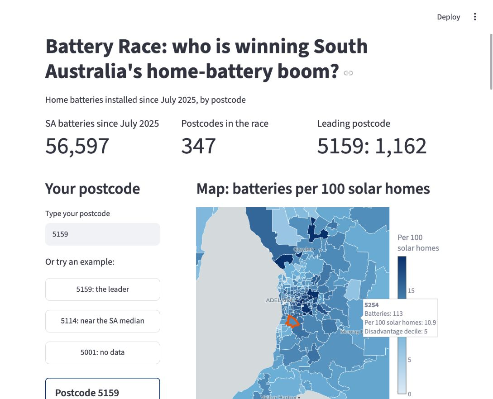
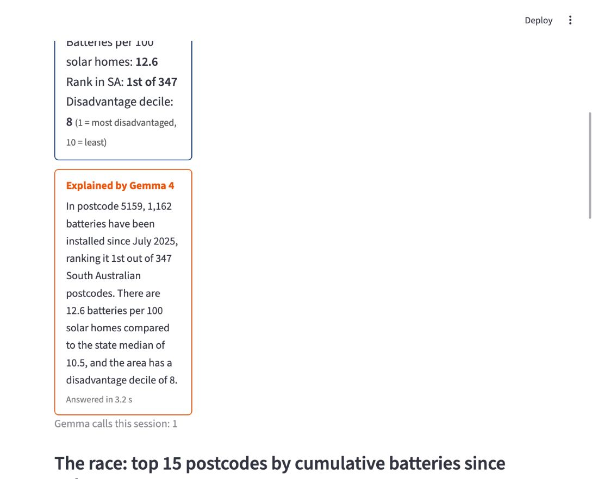
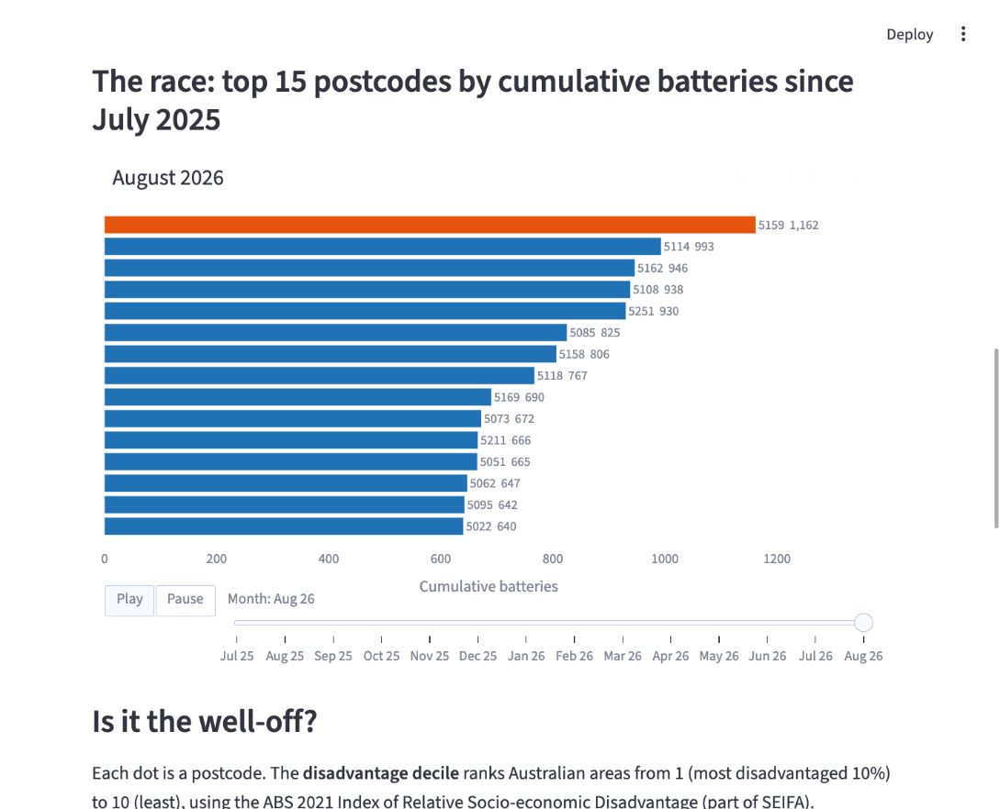
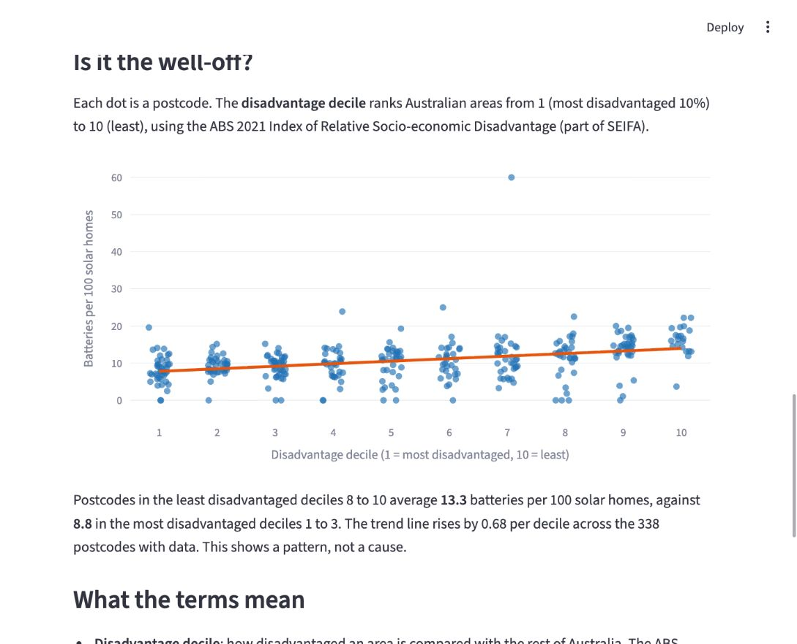

# Battery Race

**Learn from it, but do not submit it or copy its code.** Your project must be your team's own work, built during the event. Look at how it is set up, how it calls Gemma and how CoCo helped, then build your own.

Who is winning South Australia's home-battery boom? Battery Race shows how many home batteries each
South Australian postcode has installed since July 2025, when batteries joined the Small-scale
Renewable Energy Scheme. It compares each postcode against its rooftop solar and against how
disadvantaged the area is.

The app has five parts:

- A postcode card with the battery count, batteries per 100 solar homes, rank in SA and
  disadvantage decile.
- A map of batteries per 100 solar homes.
- An animated race of the top 15 postcodes month by month.
- A scatter plot of the rate against the disadvantage decile.
- A glossary of the terms used.

**What Gemma does:** when you pick a postcode, Gemma 4 explains its numbers in two or three plain
sentences. It receives only the card's facts and is told not to name suburbs, give advice or add
anything. Gemma is called at most once for each new postcode. If the call fails, the app shows a
fallback message and a "Try again" button.

## Screenshots

Captured from the original local demo on 27 October 2026, using the August 2026 data snapshot.
The Gemma explanation is a live API response, not a test fixture.

**Overview:** SA totals and the postcode map.



**Gemma explanation:** the model explains postcode 5159 using only its supplied figures.



**The race:** the top 15 postcodes at August 2026.



**Disadvantage comparison:** battery uptake by national disadvantage decile, with the app's
caution that the pattern does not establish a cause.



## Model

Gemma 4 (`gemma-4-26b-a4b-it`), called through the Gemini API with the `google-genai` SDK.
The calls use `thinking_level="minimal"` to keep answers to about 3 s.

- Terms: [Gemma 4 Apache 2.0 licence](https://ai.google.dev/gemma/apache_2) and
  [Gemini API Additional Terms of Service](https://ai.google.dev/gemini-api/terms).

## Data

| Dataset | Source | Licence | Credit line |
| --- | --- | --- | --- |
| Small-scale battery installations by postcode, to August 2026 (`data/sgu-battery-installations-2011-to-present-and-totals.csv`) | [Clean Energy Regulator](https://cer.gov.au/markets/reports-and-data/small-scale-installation-postcode-data) | [CC BY 4.0](https://creativecommons.org/licenses/by/4.0/) | Licensed from the Clean Energy Regulator, Commonwealth of Australia under a Creative Commons Attribution 4.0 licence. |
| Small-scale solar installations by postcode, to August 2026 (`data/sgu-solar-installations-2011-to-present-and-totals.csv`) | [Clean Energy Regulator](https://cer.gov.au/markets/reports-and-data/small-scale-installation-postcode-data) | [CC BY 4.0](https://creativecommons.org/licenses/by/4.0/) | Licensed from the Clean Energy Regulator, Commonwealth of Australia under a Creative Commons Attribution 4.0 licence. |
| SA monthly battery series (`data/sa_battery_monthly.csv`), made from the CER battery file above | [Clean Energy Regulator](https://cer.gov.au/markets/reports-and-data/small-scale-installation-postcode-data) | [CC BY 4.0](https://creativecommons.org/licenses/by/4.0/) | Licensed from the Clean Energy Regulator, Commonwealth of Australia under a Creative Commons Attribution 4.0 licence. |
| ABS SEIFA 2021 by postal area. Not in this repo: rebuild it in Snowflake | Australian Bureau of Statistics, through Data Army Intel's listing on Snowflake Marketplace | The listing's terms | Australian Bureau of Statistics, through Data Army Intel on Snowflake Marketplace |
| ABS postal area boundaries 2021. Not in this repo: rebuild them in Snowflake | Australian Bureau of Statistics, through Data Army Intel's listing on Snowflake Marketplace | The listing's terms | Australian Bureau of Statistics, through Data Army Intel on Snowflake Marketplace |

Details: [docs/data.md](docs/data.md).

## How CoCo helped

- **Data:** found the free Marketplace listings available in our region, then explained and checked
  SEIFA with SQL.
- **Snowflake:** loaded and reshaped the CER CSVs, built the SA join with match diagnostics, and
  exported the app files.
- **App:** built the Streamlit app and its headless tests from the spec, fixed Gemma latency, and
  added error handling.

Snowflake challenge evidence: [docs/how-coco-helped.md](docs/how-coco-helped.md).

## AI tools we used

- **Cortex Code (CoCo):** Snowflake's AI coding agent, used through the desktop app and the
  `cortex` CLI (`cortex search marketplace`).
- **Gemma 4 through the Gemini API:** the model behind the app's explanations, called with the
  `google-genai` SDK.
- **Claude Code:** prepared the original build design and app specification.
- **Codex:** checked the app, prepared this public worked example and captured its screenshots.

## Tech stack

- **Python and Streamlit:** `app.py` runs a local web app in your browser. Streamlit provides the
  postcode input, example buttons, metric cards and page layout. Selecting a postcode reruns the
  Python page; session state caches Gemma answers so repeated selections do not make another call.
- **Plotly:** draws the interactive postcode map, animated monthly race and disadvantage scatter
  plot. The map uses a CARTO basemap with OpenStreetMap attribution.
- **pandas and NumPy:** read the exported CSVs, calculate rates and rankings, reshape monthly data
  for the race, and calculate the scatter plot's trend and summaries.
- **Snowflake:** prepares the data before the app runs: loads the CER CSVs, joins them with the
  Marketplace datasets and exports local CSV and GeoJSON files. The running app needs no live
  Snowflake connection.
- **Google Gen AI SDK (`google-genai`):** sends the selected postcode's facts to Gemma 4 through
  the Gemini API and returns the explanation displayed by Streamlit.
- **python-dotenv:** loads the private Gemini API key from `.env` beside `app.py`.

The app runs on your computer; Streamlit serves its interface locally. It is not deployed inside
Snowflake or hosted on Streamlit Community Cloud. Dependencies are listed in
[requirements.txt](requirements.txt).

## App specification

[APP-SPEC.md](APP-SPEC.md) was the brief given to CoCo to build the app. It defines the page
layout, input files, data rules, Gemma prompt and acceptance checks. It describes what the app
should do; the rebuild guides explain how to produce it.

[Rebuild with CoCo](docs/rebuild-with-coco.md#b6-build-from-the-app-specification) shows the prompt
used to build from the spec. [Rebuild from scratch](docs/rebuild.md) supplies the data-preparation
SQL and commands needed before building and running the app.

## How to run

Tracks 1 and 2 cannot run the app as it is, because two of its three data files come from
Snowflake Marketplace and are not in this repo. The `cortex` CLI may also not work on event
trial accounts.

The separate [Rebuild with CoCo](docs/rebuild-with-coco.md) guide contains the design prompts
and checkpoints. [Rebuild from scratch](docs/rebuild.md) contains the SQL and commands.

Before starting the app, prepare the two files that are not distributed:
`data/sa_postcode_battery_seifa.csv` and `data/sa_postal_areas_simplified.geojson`.
Follow [docs/rebuild.md](docs/rebuild.md) to get the Marketplace listings, join the CER data in
Snowflake and export the files. The third app file, `data/sa_battery_monthly.csv`, is included
(CC BY 4.0), along with the two CER source CSVs. Once all three app files are present, the app
runs locally without a live Snowflake connection.

Copy `sample.env` to `.env` beside `app.py`, then create your key in Google AI Studio and
replace the placeholder in `.env` yourself.
Follow [the API key setup guide](docs/gemini-api-key.md) before starting the app.

From the `worked-example/` folder, run:

```bash
python3 -m venv .venv && .venv/bin/pip install -r requirements.txt
.venv/bin/streamlit run app.py
```

## Licence

The code is MIT: see [LICENSE](../LICENSE). Each dataset keeps its own licence: see [Data](#data).
